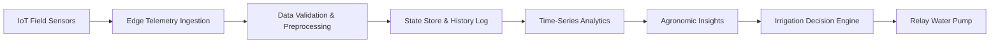

# AquaFlow – Smart Irrigation & Agricultural Data Analytics Platform

> An IoT-powered smart irrigation and telemetry platform that collects real-time agricultural sensor data, provides automated water regulation, and transforms field telemetry into analytical datasets for data engineering workflows.

[](https://vitejs.dev/)
[](https://react.dev/)
[](https://tailwindcss.com/)
[](https://opensource.org/licenses/MIT)

---

## Table of Contents

- [1. Project Overview](#1-project-overview)
- [2. Problem Statement](#2-problem-statement)
- [3. Solution Architecture](#3-solution-architecture)
- [4. Key Features](#4-key-features)
  - [Smart Irrigation & Edge Automation](#smart-irrigation--edge-automation)
  - [Data Engineering Highlights](#data-engineering-highlights)
  - [Data Analytics & Telemetry](#data-analytics--telemetry)
- [5. Why This Project Matters for My Data Engineering Career](#5-why-this-project-matters-for-my-data-engineering-career)
  - [Potential Future Data Engineering Extensions](#potential-future-data-engineering-extensions)
- [6. Technology Stack](#6-technology-stack)
- [7. System Architecture](#7-system-architecture)
- [8. Data Flow Lifecycle](#8-data-flow-lifecycle)
- [9. Analytics Showcase](#9-analytics-showcase)
- [10. Data Engineering Workflow](#10-data-engineering-workflow)
- [11. Technical Skills Demonstrated](#11-technical-skills-demonstrated)
- [12. What I Learned](#12-what-i-learned)
- [13. Project Structure](#13-project-structure)
- [14. Installation & Setup](#14-installation--setup)
- [15. Configuration](#15-configuration)
- [16. Running the Project](#16-running-the-project)
- [17. Future Improvements](#17-future-improvements)
- [18. Author & Contact](#18-author--contact)

---

## 1. Project Overview

**AquaFlow** is an end-to-end Smart Irrigation and Agricultural Telemetry platform designed to address unpredictable water usage and manual field management. By interfacing directly with an **ESP8266 NodeMCU microcontroller**, a capacitive soil moisture sensor, a DHT11 temperature/humidity module, an FC-37 rain sensor, and a relay-controlled water pump, AquaFlow automates soil moisture replenishment based on configurable agricultural thresholds.

Beyond hardware automation, AquaFlow serves as a foundational **Data Engineering and Data Analytics system**. It captures continuous, real-world edge telemetry, normalizes unstructured sensor signals into typed datasets, performs rolling time-series aggregations, and provides exportable tabular datasets for downstream data pipelines and analytics.

---

## 2. Problem Statement

Modern agriculture faces significant sustainability and operational bottlenecks:

* **Manual Irrigation Inefficiencies:** Farmers often rely on manual inspection or fixed timers, leading to over-watering or underwatered crops.
* **Severe Water Wastage:** Without rain detection and moisture feedback loops, pumps run during rainfall or when the root zone is already saturated.
* **Lack of Real-Time Soil Information:** Soil drying rates vary drastically depending on ambient temperature, humidity, and soil type.
* **Weather & Environmental Uncertainty:** Sudden temperature spikes or unpredicted rainfall alter crop water requirements dynamically.
* **Absence of Historical Sensor Data:** Traditional farms lack historical time-series logs to analyze seasonal consumption or pump duty cycles.
* **Difficulty Identifying Operational Patterns:** Without centralized telemetry, detecting sensor degradation or pump malfunctions is difficult.

---

## 3. Solution Architecture

AquaFlow bridges the gap between field hardware and data analytics through a continuous feedback loop:



---

## 4. Key Features

### Smart Irrigation & Edge Automation
* **Capacitive Soil Moisture Sensing:** Measures soil dielectric permittivity via CD74HC4067 multiplexed analog input, resistant to corrosion.
* **Atmospheric Telemetry (DHT11):** Continuously monitors ambient air temperature (°C/°F) and relative humidity (%).
* **Precipitation Detection (FC-37):** Real-time rain sensing that automatically inhibits watering cycles to conserve water resources.
* **Automated Relay Actuation:** Autonomous pump triggers when soil moisture falls below threshold ($<35\%$), with configurable safety cutoffs.
* **Manual Override & Preset Timers:** Allows manual pump activation (10s, 30s, 60s, 120s, 300s) with active countdown tracking.
* **Connection Resilience & Heartbeat:** Continuous polling with timeout handling and offline state banners.

### Data Engineering Highlights
* **Continuous Ingestion Pipeline:** Periodic polling of REST telemetry endpoints (`/api/sensors`, `/api/sensors/trends`, `/api/irrigation/history`).
* **Schema Validation & Type Coercion:** Sanitizes raw analog readings, handles missing values, and coerces dynamic timestamps.
* **Data Transformation & Normalization:** Converts raw ADC values into percentage moisture levels, formats timestamps, and calculates session runtimes.
* **Historical Event Logging:** Maintains structured records of every irrigation event, categorized by mode (`AUTO` vs `MANUAL`), trigger cause, and duration.
* **Dataset Export Engine:** Built-in client-side CSV generator allowing instant export of clean historical data for external analytical workflows.
* **Defensive Error Handling:** AbortController-backed network requests, graceful degradation when field nodes are unreachable.

### Data Analytics & Telemetry
* **Rolling Sensor Curves:** Multi-timeframe trend visualization (6h, 12h, 24h) rendered with Recharts area graphs.
* **Multi-Metric Comparison:** Toggleable telemetry curves for Soil Moisture, Ambient Temperature, and Relative Humidity.
* **Duty Cycle & Runtime Analytics:** Computes total active pump runtimes, remaining session durations, and water event frequencies.
* **Historical Querying & Filtering:** Dynamic query filtering by operational mode, date, trigger source, and completion status.

---

## 5. Why This Project Matters for My Data Engineering Career

Data Engineering is fundamentally about building robust pipelines that collect, validate, clean, transform, and store data so that organizations can extract reliable insights. 

**AquaFlow demonstrates direct exposure to core data engineering principles using real-world IoT sensor data:**

### 1. Data Collection
Unlike static CSV files or synthetic datasets, IoT sensors generate continuous, noisy environmental signals. AquaFlow samples analog moisture values, digital rain signals, and atmospheric readings at regular intervals.

### 2. Data Ingestion
Telemetry is ingested from distributed microcontrollers over HTTP REST contracts (`apiClient`), managing network latency, abort signals, and timeout intervals.

### 3. Data Cleaning & Validation
Sensor readings can arrive corrupted, null, or out-of-range. AquaFlow enforces validation guards (`sensorService.js`), replacing missing or corrupted values with null-safe defaults and sanitizing timestamps.

### 4. Data Transformation
Raw analog readings (ADC counts) are transformed into calibrated metrics:
* Analog ADC voltage $\rightarrow$ Calibrated Soil Moisture Percentage ($0-100\%$)
* Raw Celsius readings $\rightarrow$ Fahrenheit conversion for dual-unit analytics
* Millisecond epoch ticks $\rightarrow$ ISO-8601 strings and local time labels (`formatters.js`)
* Duration in seconds $\rightarrow$ Human-readable runtime strings

### 5. Structured Data Storage & State Management
Processed records are mapped into structured objects within application context and local storage, ensuring immutable event histories.

### 6. Pipeline-Oriented Architecture
Data flows in a unidirectional pipeline:
$$\text{Raw Sensor ADC} \longrightarrow \text{Edge Ingestion} \longrightarrow \text{Sanitization} \longrightarrow \text{State Store} \longrightarrow \text{Analytical Dashboards / CSV Export}$$

### 7. Data Analytics
Recharts-powered aggregations map time-series vectors onto smooth curves, enabling farmers to identify soil moisture drying rates and correlations with ambient temperature.

### 8. Real-World Data Challenges
Handles network dropouts, device restarts, clock drift, and noisy sensor fluctuations with graceful offline states and connection retry policies.

### 9. Scalability Mindset
The architecture decouples the sensing layer from the presentation layer via clean service abstractions (`sensorService`, `pumpService`, `deviceService`), allowing easy migration to message queues and cloud lakes.

---

### Potential Future Data Engineering Extensions

*(These are planned architectural extensions for cloud-scale multi-farm deployments)*

* **Streaming Ingestion:** Apache Kafka or AWS Kinesis to ingest high-frequency telemetry from thousands of field nodes.
* **Pipeline Orchestration:** Apache Airflow DAGs to schedule batch aggregation, model calibration, and report generation.
* **Distributed Processing:** Apache Spark / PySpark for large-scale historical trend analysis and soil moisture predictive modeling.
* **Data Warehousing & Cloud Storage:** S3 / MinIO for raw Parquet telemetry lakes, with Snowflake or Google BigQuery for analytical queries.
* **Containerized Deployment:** Docker and Kubernetes manifests for orchestrating ingestion microservices and gateways.

---

## 6. Technology Stack

### Hardware Layer
* **Microcontroller:** ESP8266 NodeMCU (Wi-Fi enabled edge computing)
* **Soil Moisture Sensor:** Capacitive Soil Moisture Sensor v1.2 (corrosion-resistant)
* **Atmospheric Sensor:** DHT11 Temperature & Relative Humidity Sensor
* **Precipitation Sensor:** FC-37 Rain Detection Board
* **Multiplexer:** CD74HC4067 16-Channel Analog Multiplexer
* **Actuation:** 5V Single-Channel Relay Module controlling a Submersible DC Water Pump

### Software Layer
* **Frontend Framework:** React 19 (React Hooks, Context API)
* **Build Tool & Dev Server:** Vite 7
* **Styling & Design System:** Tailwind CSS 3 with PostCSS & Autoprefixer
* **Visualization & Analytics:** Recharts 3 (Area & Line time-series charts)
* **Icons & UI Assets:** Lucide React
* **Routing:** React Router v7

### Data & Transport Layer
* **Protocol:** HTTP REST with JSON payloads
* **Transport Control:** Native Fetch API with `AbortController` timeout management
* **Local Persistence:** Browser `localStorage` for endpoint configuration and caching
* **Data Export:** RFC-4180 compliant CSV Dataset Export Engine

---

## 7. System Architecture

```text
┌────────────────────────────────────────────────────────┐
│                   IoT HARDWARE LAYER                   │
│                                                        │
│  [Capacitive Moisture] [DHT11 Temp/Hum] [FC-37 Rain]   │
│             │                  │             │         │
│             └──────────┬───────┴─────────────┘         │
│                        ▼                               │
│              [CD74HC4067 Multiplexer]                  │
│                        ▼                               │
│             [ESP8266 NodeMCU Firmware]                 │
│                        │                               │
│              [Relay D1 -> Water Pump]                  │
└────────────────────────┼───────────────────────────────┘
                         │ HTTP REST / Wi-Fi
                         ▼
┌────────────────────────────────────────────────────────┐
│             AQUAFLOW DATA & INGESTION LAYER            │
│                                                        │
│  apiClient (AbortController, Timeout, Network Guard)   │
│                        ▼                               │
│  sensorService & irrigationService Data Normalizers    │
│                        ▼                               │
│  IrrigationContext State Engine (Event Store & Buffer) │
└────────────────────────┼───────────────────────────────┘
                         │
                         ▼
┌────────────────────────────────────────────────────────┐
│             ANALYTICS & VISUALIZATION LAYER            │
│                                                        │
│  ┌──────────────────┐ ┌──────────────────┐ ┌─────────┐ │
│  │ Real-Time Cards  │ │ Recharts Trends  │ │ CSV     │ │
│  │ Telemetry Metric │ │ Multi-Timeframe  │ │ Dataset │ │
│  │ Soil/Temp/Rain   │ │ 6h / 12h / 24h   │ │ Exporter│ │
│  └──────────────────┘ └──────────────────┘ └─────────┘ │
└────────────────────────────────────────────────────────┘
```

---

## 8. Data Flow Lifecycle

The lifecycle of an individual telemetry sample through AquaFlow:

```text
1. Sensor Reading: Hardware transducer outputs analog/digital voltage
         │
2. Edge Sampling: Multiplexer selects sensor channel; ESP8266 reads ADC
         │
3. Payload Serialization: Edge node packages reading into structured JSON
         │
4. HTTP Ingestion: apiClient issues request with 3000ms AbortController
         │
5. Validation: Null-checks, bounds checking, and type guards applied
         │
6. Transformation: Raw ADC counts scaled to 0-100% moisture; timestamping
         │
7. Event Buffering: Telemetry point appended to rolling trend state buffer
         │
8. Decision Trigger: Threshold evaluation (Moisture < 35% AND Rain == False)
         │
9. Analytics & Output: Recharts curve re-renders; entry available for CSV export
```

---

## 9. Analytics Showcase

AquaFlow converts operational field telemetry into analytical metrics:

| Metric | Source Sensor | Unit | Sampling Objective | Agronomic Significance |
| :--- | :--- | :--- | :--- | :--- |
| **Soil Moisture** | Capacitive V1.2 | `%` | Root-zone volumetric water content | Triggers irrigation when $<35\%$; prevents root rot if $>80\%$ |
| **Temperature** | DHT11 | `°C / °F` | Ambient surface air temperature | Identifies evapotranspiration peaks during high heat |
| **Humidity** | DHT11 | `%` | Atmospheric relative humidity | Informs vapor pressure deficit and water retention |
| **Rain Detection** | FC-37 Plate | `Boolean` | Real-time precipitation event | Critical safety inhibitor: cancels pump cycles during rain |
| **Pump Duration** | Relay State Log | `Seconds` | Cumulative pump actuation runtime | Tracks water volume usage and operational power costs |

### Telemetry Observations
* **Evaporative Depletion:** Shows diurnal soil moisture decay during midday temperature peaks.
* **Precipitation Spikes:** Immediate transition to safe standby mode upon rain detection, eliminating unnecessary pump cycles.
* **Historical Auditability:** All manual and autonomous cycles logged with start time, duration, and trigger rationale.

---

## 10. Data Engineering Workflow

```text
IoT Sensors ──► Data Ingestion ──► Data Validation ──► Data Transformation ──► State Storage ──► Analytics & CSV Export
```

* **Data Ingestion:** Periodic heartbeat polling gathers telemetry without blocking UI interactions.
* **Data Validation:** Strict type assertions prevent `NaN` or `undefined` values from polluting analytical charts.
* **Data Transformation:** Time formatting, status classification (`Dry`, `Optimal`, `Wet`), and runtime unit conversions.
* **State Storage:** Reactive in-memory state with browser persistence for custom endpoint configurations.
* **Data Analysis & Export:** Exportable historical records formatted as clean CSV tables for downstream exploration in Python, Pandas, or Excel.

---

## 11. Technical Skills Demonstrated

* **Data Ingestion & Extraction:** REST API consumption, asynchronous request pipelines, HTTP timeout guards (`AbortController`).
* **Data Cleaning & Normalization:** Safe type coercion, handling incomplete payloads, dynamic timestamp formatting.
* **Data Modeling & Schemas:** Defined domain entities for Telemetry, Irrigation Events, Device Heartbeats, and Control States.
* **Data Visualization:** Time-series area charts, responsive metric cards, dynamic color indicators, and trend intervals.
* **IoT & Embedded Interfacing:** Sensor integration (capacitive soil, DHT11, FC-37), multiplexing (CD74HC4067), and relay actuation.
* **Modern Web Development:** React 19, JavaScript ES6+, Vite, Tailwind CSS, Component Modularization.
* **Software Engineering Best Practices:** Environment isolation (`.env.example`), clean `.gitignore`, reproducible dependency locking.

---

## 12. What I Learned

* **Real-World Sensor Behavior:** Sensor outputs are rarely linear or noise-free; defensive data transformation and validation are vital.
* **Resilient Data Pipelines:** Network drops happen regularly in agricultural IoT; client code must handle disconnects without crashing.
* **End-to-End System Thinking:** How hardware actuation, edge communication, frontend state management, and analytical reporting intersect.
* **Dataset Usability:** Structuring event logs with clear schema definitions (timestamp, duration, trigger, mode) makes downstream analysis straightforward.

---

## 13. Project Structure

```text
AquaFlow/
├── public/
│   ├── favicon.svg             # Application favicon
│   └── icons.svg               # SVG asset definitions
├── src/
│   ├── assets/                 # Static graphical assets
│   │   ├── hero.png
│   │   ├── typescript.svg
│   │   └── vite.svg
│   ├── components/             # Reusable modular UI components
│   │   ├── common/             # Buttons, Cards, StatusBadges, Toasts, OfflineBanner
│   │   ├── dashboard/          # SensorGrid, LiveTrendPreview, PumpControlCard, AutoModeStatusCard
│   │   └── history/            # HistoryTable with filtering & CSV Dataset Export
│   ├── context/
│   │   └── IrrigationContext.jsx # Global telemetry state, polling engine & command dispatcher
│   ├── layouts/                # Header, Sidebar, and MainLayout wrappers
│   ├── pages/                  # Routed views: Dashboard, History, Sensors, Settings
│   ├── services/               # Modular API and edge abstraction layer
│   │   ├── api.js              # Base HTTP client with AbortController timeout handling
│   │   ├── deviceService.js    # Edge device heartbeat & diagnostic endpoints
│   │   ├── irrigationService.js# Historical irrigation event retrieval
│   │   ├── pumpService.js      # Relay actuation command dispatching
│   │   └── sensorService.js    # Telemetry sampling & rolling trend endpoints
│   ├── types/
│   │   └── irrigation.js       # Domain constants (PumpState, IrrigationMode, MoistureStatus)
│   ├── utils/
│   │   └── formatters.js       # Formatting utilities for time, date, and moisture status
│   ├── App.jsx                 # Client router configuration
│   ├── index.css               # Tailwind CSS base styles and design system variables
│   └── main.jsx                # Application entrypoint
├── .env.example                # Environment configuration template
├── .gitignore                  # Git ignore rules for node_modules, build artifacts & secrets
├── index.html                  # HTML5 document entrypoint
├── package.json                # Project dependencies and script declarations
├── package-lock.json           # Deterministic dependency lockfile
├── postcss.config.js           # PostCSS plugin configurations
├── tailwind.config.js          # Tailwind CSS theme and styling configuration
├── tsconfig.json               # Type-checking configuration
└── vite.config.js              # Vite bundler configuration
```

---

## 14. Installation & Setup

### Prerequisites
* **Node.js:** v18.0.0 or higher
* **npm:** v9.0.0 or higher

### Steps

1. **Clone the repository:**
   ```bash
   git clone https://github.com/DHARINEESHRK/aquaflow-smart-irrigation-data-engineering.git
   cd aquaflow-smart-irrigation-data-engineering
   ```

2. **Install project dependencies:**
   ```bash
   npm install
   ```

---

## 15. Configuration

1. Copy the example environment file:
   ```bash
   cp .env.example .env
   ```

2. Configure the target endpoint URL:
   ```env
   # Base URL for the ESP8266 NodeMCU REST API gateway
   VITE_API_BASE_URL=http://192.168.137.253/api
   ```
   *(You can also configure or override the endpoint dynamically at runtime from the **Settings** page in the UI).*

---

## 16. Running the Project

### Development Server
Start the local development server with hot-module reloading:
```bash
npm run dev
```
Open `http://localhost:5173` in your browser.

### Production Build
Build optimized static production assets:
```bash
npm run build
```

### Preview Production Build
Preview the production build locally:
```bash
npm run preview
```

---

## 17. Future Improvements

* [ ] **MQTT / WebSocket Telemetry Streaming:** Real-time push updates rather than polling.
* [ ] **Cloud Data Pipeline Integration:** Ingest sensor events into Apache Kafka and AWS S3 telemetry lakes.
* [ ] **Predictive Soil Moisture Forecasting:** Machine learning models predicting moisture depletion based on weather forecasts.
* [ ] **Multi-Zone Valve Support:** Scalable multiplexing for agricultural plots with multiple independent irrigation zones.
* [ ] **Docker Containerization:** Dockerfile and Docker Compose configurations for containerized deployments.

---

## 18. Author & Contact

**R.K. Dharineesh**
* GitHub: [@DHARINEESHRK](https://github.com/DHARINEESHRK)
* Email: [dharineeshrk213@gmail.com](mailto:dharineeshrk213@gmail.com)

---

*AquaFlow – Engineering data solutions for sustainable agriculture.*
